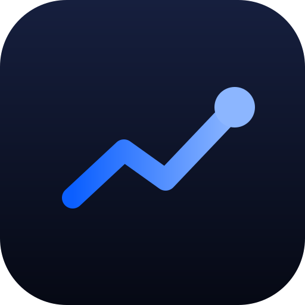

<p align="center">
  
</p>

<h1 align="center">FolioDash</h1>

<p align="center">
  <strong>A clearer view of your money.</strong><br>
  Your portfolio history and the everyday cost of work, together in one personal dashboard.
</p>

<p align="center">
  <a href="https://albidr.github.io/FolioDash/"><strong>Explore the demo</strong></a> ·
  <a href="#the-whole-picture">The whole picture</a> ·
  <a href="#a-closer-look">A closer look</a> ·
  <a href="#how-it-works">How it works</a> ·
  <a href="#run-locally">Run locally</a>
</p>

<p align="center">
  <a href="https://github.com/AlbiDR/FolioDash/actions/workflows/verify.yml"></a>
  <a href="#under-the-hood"></a>
  <a href="#under-the-hood"></a>
</p>

<br>

<p align="center">
  <picture>
    <source media="(prefers-color-scheme: dark)" srcset="https://albidr.github.io/FolioDash/readme/hero-dark.png">
    
  </picture>
  <br>
  <sub>The current application, with invented demo data. Screenshots refresh with each successful site release.</sub>
</p>

<br>

## The whole picture

A statement tells you what your funds are worth on a date. FolioDash connects those snapshots into a history of your investments, cash decisions and progress. Alongside it, a dedicated workday tracker makes travel, meals and other expenses easier to understand.

<table>
  <tr>
    <td width="33%" valign="top">
      <h3>Portfolio</h3>
      Value, invested capital and gain together. Follow the timeline, then look into each fund.
    </td>
    <td width="33%" valign="top">
      <h3>Workday</h3>
      Record travel, meals and other costs. See the week behind your daily spending.
    </td>
    <td width="33%" valign="top">
      <h3>Your records</h3>
      Review each import before saving. Keep statements and cash decisions in your own Google spreadsheet.
    </td>
  </tr>
</table>

<br>

## A closer look

One visual language across the portfolio, the working week and the phone in your pocket: clear figures, responsive cards, purposeful motion and a single control to hide amounts.

<table>
  <tr>
    <td width="72%" align="center" valign="top">
      <picture>
        <source media="(prefers-color-scheme: dark)" srcset="https://albidr.github.io/FolioDash/readme/expenses-dark.png">
        
      </picture>
      <br>
      <sub><b>The working week</b><br>Five categories. Daily detail. A wider view of what work costs.</sub>
    </td>
    <td width="28%" align="center" valign="top">
      
      <br>
      <sub><b>A view that fits</b><br>The same portfolio, arranged for a smaller screen.</sub>
    </td>
  </tr>
</table>

<p align="center"><sub>Desktop and phone-sized browser views, with invented demo data.</sub></p>

<br>

## How it works

1. **Get a feel for it.** Open the demo and explore an invented portfolio and expense history. No account is needed; demo expense edits reset on reload.
2. **Bring your history.** For your own records, connect Google and choose supported bank Excel exports, separately or in a workbook with a statement per sheet. Check dates, holdings and cash movements before confirming.
3. **Make it a routine.** Return to your portfolio, look into a fund, or record a workday. You can track expenses without importing a portfolio.

The interface uses English labels and Italian/EUR formatting. The installable app is designed for Mac and Android; [installation and device evidence](docs/operations/pwa.md) records what has been checked.

> **An early build, ready to explore.** The demo runs without Google. Full Google integration and physical-device acceptance are still in progress. [Current evidence](docs/operations/onboarding-acceptance.md).

<br>

## Run locally

Use **Node.js 22.18.0 or newer** and npm.

```sh
git clone https://github.com/AlbiDR/FolioDash.git
cd FolioDash
npm ci --ignore-scripts
npm run dev
```

Open the URL printed by Vite. The demo is ready without credentials or configuration.

For local Google access, use an existing public OAuth client ID with that origin authorised. Enter it in **Your data > Advanced: Google client ID**, or supply `VITE_GOOGLE_CLIENT_ID` when starting or building the app. For provider tests, use the isolated [synthetic onboarding procedure](docs/operations/onboarding-acceptance.md); ordinary sign-in can reconnect an existing workbook.

<br>

## Under the hood

**TypeScript · Preact · Vite · SVG charts · Google Sheets**

One pure financial kernel owns the calculations. Use cases connect it to the interface and adapters, while your Google workbook remains the durable record. The browser keeps a rebuildable device copy for faster reads and offline viewing. [Explore the architecture](docs/architecture/cleanstack.md).

<details>
<summary><strong>Development and verification</strong></summary>

<br>

```sh
npm run verify
npm run audit:dependencies
```

Verification covers repository boundaries, attribution and punctuation policies, types, lint, tests, Pages artifact integrity, production/PWA output and the retained Apps Script bundle. The dependency audit fails on moderate or greater severity. CI checks Node 22 and 24; the existing Pages pipeline publishes the checked artifact. Workflow edits also require `npm run verify:workflows`.

For a production preview, run `npm run build`, then `npm run preview`. README screenshots refresh automatically with successful `main` releases. CI captures the checked build in a fresh browser profile, blocks external requests, and publishes the images at stable Pages URLs. No screenshot commits or manual recaptures are needed.

To reproduce locally, run `npm run build`, `npm run capture:readme`, then `npm run prepare:pages`. `CHROME_PATH` selects a Chrome executable when needed. Capture output stays in ignored `dist/readme/`; `dist/pages/` combines it with a byte-for-byte copy of the checked application.

Read the [working agreement](AGENTS.md), [contribution guide](.github/CONTRIBUTING.md) and [Actions guide](docs/operations/github-actions.md) before changing the project. Licensing remains undecided; external contributions cannot be accepted yet.

</details>

<details>
<summary><strong>Current scope and data</strong></summary>

<br>

- **Imports:** the supported Fideuram XLSX layout, with one statement per calendar month, appended chronologically. Other bank layouts and earlier-history insertion are unsupported. A history import saves statement by statement and preserves confirmed saves if interrupted. [Import workflow](docs/operations/importing-history.md).
- **Expenses:** today and earlier Monday-Friday workdays, stored separately within the same workbook. Complete correction-history backup and confirmed restoration into a never-initialised expense store are implemented. Portfolio JSON export is not implemented; portfolio device recovery omits original bank statements. [Expense definitions and recovery](docs/operations/work-expenses.md).
- **Financial meaning:** exact EUR cents and the accepted `legacy-parity-v1` policy. Year to date starts at the January statement. Cash-timing percentages are estimates; no returns are annualised, time-weighted or money-weighted. [Reporting decisions](docs/architecture/decision-register.md#fd-007-financial-policy-questions).
- **Data ownership:** direct Google access uses user authorisation and `drive.file`. Device copies are plain local data; signing out or choosing Forget this device clears them without deleting the workbook. Financial saves require Google; uncertain outcomes are checked before continuing. This is not FolioDash end-to-end encryption. [Data and connection decisions](docs/architecture/decision-register.md).
- **Evidence:** a one-account synthetic portfolio create/save/read-back/replay flow passed from an Android emulator at a local origin. Live expense writes, deployed-origin and two-account acceptance, simultaneous-device proof, and physical Android/WebAPK checks remain separate gates. Screenshots establish presentation only. [Onboarding evidence](docs/operations/onboarding-acceptance.md) · [Web quality contract](docs/operations/web-quality.md).

Keep real statements, identifiers, private screenshots, backups and credentials outside the repository, fixtures, logs and builds. GitHub secrets belong to deployment/CI. Original-file archival, retention duration and broader session/privacy acceptance remain open. The existing Google Sheets project stays separate.

</details>

<br>

<p align="center">
  <a href="https://albidr.github.io/FolioDash/"><strong>Explore FolioDash</strong></a> ·
  <a href="docs/README.md">Documentation</a> ·
  <a href="docs/architecture/decision-register.md">Project decisions</a>
</p>
