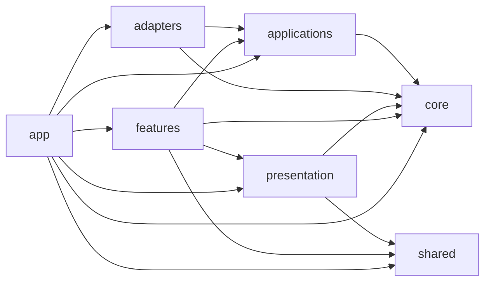

# Repository map

Generated by `npm run docs:map`; do not edit. `npm run verify:docs` fails when it is out of date. The folder tree lists directories only, and the diagram shows which layer imports which, taken from the real imports of production source.

## Layer dependencies

An arrow means some file in the first layer imports a file in the second. The rules that allow or forbid each arrow are in [CleanStack](cleanstack.md) section 4.1 and are enforced by `npm run verify:repository`.



## Folders

```text
src/
├── adapters/
│   ├── browser/
│   │   ├── connection/
│   │   └── storage/
│   ├── fideuram/
│   ├── google/
│   │   ├── direct-expenses-suites/
│   │   ├── direct-ledger-suites/
│   │   ├── expenses/
│   │   ├── ledger/
│   │   └── workbook/
│   ├── ledger/
│   └── xlsx/
├── applications/
│   ├── import/
│   ├── ledger/
│   └── session/
├── core/
│   ├── expenses/
│   ├── integrity/
│   ├── portfolio/
│   ├── statements/
│   └── values/
└── interfaces/
    └── web/
        ├── app/
        │   ├── demo/
        │   ├── platform/
        │   ├── session/
        │   │   ├── checkpoint/
        │   │   ├── checkpoint-suites/
        │   │   ├── expense/
        │   │   ├── expense-suites/
        │   │   ├── session-suites/
        │   │   └── stack/
        │   └── styles/
        ├── features/
        │   ├── account/
        │   ├── activity/
        │   │   └── styles/
        │   ├── checkpoints/
        │   ├── expenses/
        │   │   └── styles/
        │   ├── history/
        │   ├── import/
        │   └── overview/
        │       ├── model/
        │       └── styles/
        ├── presentation/
        │   ├── charts/
        │   │   └── motion/
        │   └── privacy/
        ├── public/
        │   ├── icons/
        │   ├── privacy/
        │   └── social/
        ├── service-worker/
        └── shared/
            ├── motion/
            └── ui/
                └── motion/
```

```text
tests/
├── fixtures/
│   ├── google-adapters/
│   └── session/
├── performance/
├── properties/
├── regression/
├── scripts/
└── setup/
```

```text
scripts/
├── artifacts/
│   └── portfolio-study/
├── audit/
│   ├── interactions/
│   └── motion/
├── docs/
├── lib/
├── setup/
└── verify/
    ├── code/
    ├── output/
    └── project/
```

```text
config/
```

```text
docs/
├── architecture/
├── design/
└── operations/
```
