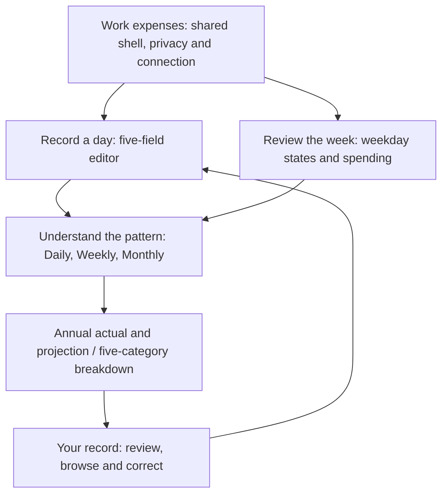

# Work expenses in FolioDash: consolidated experience plan

Date: 2026-11-04

Status: Refined and audited design proposal. Preparation only; no tracker UI, calculations, routes or spending storage implemented. Owner-confirmed scope and day meanings remain authoritative in the [preparation contract](../architecture/work-expenses-tracker.md). Recommendations here are implementation guidance, not accepted financial policy or authority for live writes.

This plan moves from the whole application to the dashboard, then to entry and recovery. Each pass was audited against existing source and consolidated into the recommendations below. The audit is a source and design review, not independent reviewer, usability or browser evidence.

## 1. Whole-product narrative

FolioDash should make a person's recorded money understandable at a glance and make the next useful action obvious. Portfolio explains the investments recorded in bank statements. Work expenses explains the cost of recorded working days. They share one visual language, privacy control and connection, while retaining their own dates, facts and calculations.

The tracker narrative is **record a day, review the week, understand the pattern**. This determines prominence and reading order. A large entry card supports the daily habit; a weekly overview gives immediate context; summaries and history explain the accumulated record. The bento composition gives each question a clear home and a deliberate visual weight.

| Product decision | Consolidated recommendation | Reason |
|---|---|---|
| Main navigation | Add Expenses alongside Portfolio, Import and Your data. Page title: Work expenses. Keep the same four destinations on desktop and mobile. | The frequent daily task deserves direct access; the page title makes its work-only scope clear. |
| Existing Portfolio | Retain its investment story, headline value, trend, metrics and fund details. | Spending does not change investment performance or become portfolio cash movements. |
| Landing | Preserve the existing Portfolio default and support a direct link to Work expenses. | Adding the tracker need not force a new Home screen or change an established route. |
| Entry to Expenses | Open Today on a fresh visit; retain an active unsaved draft when returning within the same session. | The usual task is immediate without sacrificing unfinished work. |
| Local destinations | Keep day entry, week context and summary inspection on one Expenses page. Open the full record as a secondary view within that feature. | Avoid separate Today, Calendar, Reports and Categories main tabs for five fields. |
| Shared toolbar | Keep page title, account source and privacy. Put the expense reporting year and week controls inside the tracker. | Portfolio's Chart period is not a spending filter; app connection is not a day-save receipt. |
| Import | Keep the existing Import destination for bank statements. If legacy expense import is later authorised, start its explicitly labelled review from Expenses. | Existing bank parsing must not guess at a work-expenses workbook. |
| Your data | Eventually describe portfolio and expense coverage separately under the same workbook connection. | A saved portfolio copy is not a complete future expense backup. |

No blended net-worth total, gain-versus-lunch comparison, budget score, savings advice or new generic financial home belongs in this milestone. These would need new facts, definitions and product scope.

### Pass 1 audit and consolidation

Source reviewed at preparation revision `ebef320`: `App.tsx`, `routes.ts`, `OverviewView.tsx`, `AccountView.tsx`, privacy presentation, shared tokens, and the mobile, interaction and web quality contracts. A final cross-check also read the concurrent dashboard consolidation: total gain stays in the portfolio hero, three period cards follow, chart controls sit outside the shared header and deeper analysis uses disclosure. This plan follows that hierarchy and leaves that work's implementation ownership intact.

| Finding | Resolution in this plan |
|---|---|
| Current shell has Portfolio, Import and Your data; month/fund details belong to Portfolio. | Add one feature destination and keep its detail views under the same selected destination. |
| The reviewed baseline equates recorded data with portfolio snapshots and otherwise supplies demo portfolio data. Concurrent consolidation corrects the connected-empty display fallback. | Still require feature-aware session, cache, recovery and empty-state coverage before enabling expenses; a spending-only account must not be treated as an empty account or silently shown invented portfolio figures as its own. |
| Current onboarding directs a connected empty workbook to bank import. | Offer the Expenses path without requiring an investment statement. Portfolio may still show its own explicit empty state. |
| The existing grid, solid content surfaces, glass navigation and blue accent already form a coherent system. | Extend those materials and hierarchy; introduce no competing card, icon or motion library. |
| A global source chip could be mistaken for confirmation of a new entry. | Keep per-entry persistence feedback beside the Save action. |

## 2. Dashboard composition and visual strategy

Use the existing twelve-column desktop grid and content-driven card heights. Choose card width by importance and reading needs. Recompose into a single readable phone sequence; do not shrink a desktop mosaic until its labels fit poorly. The [mobile dashboard](mobile-dashboard.md) and [web quality contract](../operations/web-quality.md) own responsive and accessibility rules.

This is a proposed information hierarchy, not a component dependency graph. A companion static desktop/phone illustration uses synthetic content and is delivered as a review artifact outside the repository under its documentation-only file policy. Neither diagram proves a working tracker, responsive layout or reporting calculations. The table below is the persistent composition specification.

| Order / question | Desktop role | Content and useful interaction | Phone composition |
|---|---|---|---|
| 1. What am I recording? | Entry card, 7 columns | Selected weekday/date, previous/next, Today, five fields, entry state, day amount and one Save action | First full-width card, with natural height for the five labelled inputs; date actions wrap |
| 2. How does this week look? | Week card, 5 columns | Explicit Monday-Friday range, five date buttons with day states, recorded week spending and any incomplete-day count | Next full-width card; five buttons become five readable rows when labels or targets need room |
| 3. What is typical? | Average Daily, Weekly and Monthly, 4 columns each | All three legacy averages, with units, selected year, applicable period counts and partial-data explanation | Full-width metric cards, no compulsory horizontal carousel |
| 4. What has accumulated? | Annual card, 5 columns | Total Yearly and separately labelled Yearly Projection, each with its own definition and data availability | Full-width card with stacked actual and estimate sections |
| 5. Where does spending go? | Category card, 7 columns | A named disclosure opens five horizontal category bars with labels and exact values, plus a readable table | Full-width; bars beneath labels when narrow |
| 6. What needs review? | Record card, 12 columns | Recent workdays and partial entries, with a View all days action and year/month browsing | Date rows with status, amount and Edit action; secondary details expand |

Daily entry retains visual priority even when reporting history grows. Record review must be reachable directly from an incomplete-day cue near the entry/week cards, without first scrolling through every report. The year selector governs the report cards only. The week range governs the week card only. The selected date governs the editor only. Label these scopes beside their controls; no control silently changes all three.

Keep the entry, week, all five required summary figures and recent record visible. Category analysis and detailed definitions start collapsed behind named, keyboard-operable disclosures. This follows the portfolio consolidation's progressive disclosure without hiding the tracker's required summaries or review actions. The composition illustration expands the category area only to explain its intended role.

Proposed coupling: previous/next or picking a day moves the editor and its containing week together. A week-browse action changes the displayed week without replacing an unsaved editor; selecting a day then follows the draft-navigation rule. A reporting-year change does not move the editor or discard a draft. Returning from the full record restores its browsing context.

### Craft rules

- Keep one dominant blue-toned action card, quieter solid supporting cards, consistent insets and aligned label/value baselines. Reuse existing radii, typography and shadows. Glass stays in navigation and toolbars.
- Place date and state before amounts. Use tabular numerals and Italian/EUR formatting. Every metric has a period and unit; an estimate carries the word Estimate and its method.
- Treat expense amounts neutrally. A higher cost is not automatically a loss and a lower cost is not automatically a success. Category colours identify categories consistently and never carry meaning alone.
- A card answers one question. Make its action a named link/button; informational cards keep normal reading semantics. Avoid nested clickable card surfaces around editable fields.
- Preserve calm space through alignment and grouping. Do not add decorative widgets to fill an empty grid cell or force equal card heights that create dead space.
- Prefer the five-category horizontal comparison over another allocation ring: full labels and values remain easy to scan. Reuse existing financial presentation where appropriate without importing portfolio feature components.
- Do not put a sparkline on every metric. Add a time chart only when an approved question and reporting policy justify it; retain dates, zeroes and gaps correctly.

### Pass 2 audit and consolidation

| Challenge | Resolution |
|---|---|
| A summary-first dashboard buries the action needed every weekday. | Entry and its week context lead; reporting follows. |
| Five equally prominent KPI tiles compete with five entry fields. | Three typical-cost cards form one reporting row; actual yearly spending and its estimate are grouped with explicit separation. All five legacy summaries remain present. |
| A calendar heatmap could make blank/no-work and zero-cost days indistinguishable. | Use labelled weekday states first; defer a heatmap until it answers a demonstrated need. |
| Selecting an old day could unexpectedly rewrite annual reports. | Separate editor date, displayed week and reporting year, with explicit scope and deliberate coupling. |
| A partial amount could look like a complete total. | Say Recorded so far when incomplete; show missing-field counts. Report inclusion remains a financial-policy gate. |
| On phones, a five-column week or pinned action bar can obscure content and the keyboard. | Allow a five-row week; keep Save in normal flow initially, respect navigation/safe areas, and test the real keyboard before considering sticky actions. |

## 3. Daily journey and interaction detail

### Entry sequence

1. Open Expenses. Show Today with a real date, connection context and either the stored entry or an untouched form. A fresh form has no zero-valued placeholders and creates no records.
2. Enter amounts in the existing category order: Outbound Commute, Lunch, Inbound Commute, Dinner, Other Expenses. Preserve familiar English labels and the existing Italian/EUR display convention. Specify accepted keyboard decimal formats in the parser contract before implementation.
3. Give each field a permanent label, EUR context and a clear difference between blank and an entered 0. Validate on an appropriate interaction boundary, retain editable text while typing, and avoid disruptive formatting/caret changes. Enter and Tab must not accidentally save the whole form.
4. Show entered-field count and the draft amount. With blanks remaining, label it Recorded so far rather than a final daily total. Zero is a real value and counts as filled.
5. Save explicitly. A complete entry uses Save day. Proposed partial-entry treatment: retain known amounts across devices through a clearly labelled Save partial day action and inline explanation. This requires a reviewed partial-record storage contract; it is not yet an implemented or owner-selected policy. Never manufacture zeroes to make an entry complete.
6. Keep the selected day visible after saving. Update week/report projections from the confirmed record, preserve focus sensibly and show a persistent Saved state. Saving does not advance to tomorrow or suggest that another field is missing when all five contain zeroes.

A secondary No costs today convenience action is worth evaluating in the prototype: fill all five draft fields with 0, allow editing, then use the normal Save action. It must not overwrite existing amounts without review or submit automatically. It is optional interaction design, not a new category or accepted requirement.

### Day meaning and save state are separate

The preparation contract owns classification. The following presentation vocabulary makes that classification understandable without changing it.

| Day meaning | Visible description | Amount treatment |
|---|---|---|
| Empty current weekday | Not entered yet | No zero total; entry prompt |
| Entirely blank past weekday | No work | Explicit text; not a zero-cost workday |
| Five amounts present | Recorded workday | Complete amount, including EUR 0,00 for five zeroes |
| Some amounts present | Needs review, with missing-field count | Recorded so far; no guessed full total |
| Empty future weekday | Future date | May hold an unsaved preparation draft; no automatically confirmed future spending |

Scope boundary to decide before reporting: the start of tracked history. A past blank weekday inside that agreed range means no work under the owner's rule. Do not infer years of no-work days before tracking began, or claim coverage for history not imported. A missing/corrupt/unreadable stored record is a data-access problem, never evidence of a blank day. Today remains an open date until it has become past under the date-only local-date policy; define timezone and midnight behaviour in the canonical model, not each component.

| Persistence state | Feedback and permitted action |
|---|---|
| Unchanged / untouched | No unsaved warning and no write on navigation |
| Edited draft | Unsaved changes beside the action; reports still use confirmed records |
| Saving | Real progress, duplicate submission prevented, draft retained |
| Saved | Confirmation only after authoritative acknowledgement/read-back; partial days can be saved and still need review |
| Known not saved | Explain the reason; retain values and offer the supported recovery action |
| Outcome unknown | Checking save outcome; reconcile the same command before any retry |
| Saved, view unavailable | Explain that the entry is saved and refresh/rebuild the view safely |

These axes must remain independent: a saved partial day still needs review, while a complete unsaved draft is not part of reports. The account source chip describes the account connection and must not stand in for either axis.

### Navigation, correction and exceptions

- Previous/next browse Monday-Friday; a date picker jumps directly to a supported weekday. A weekend visit explains the workweek and offers the adjacent weekdays, rather than silently assigning its amounts to Friday or Monday. Today names the actual date; weekend behaviour must be resolved in the prototype.
- Keep date controls outside the five-field tab sequence. Preserve focus on the activated date control, announce the new date/state and avoid remounting the entire dashboard. A date change does not trigger Save.
- Before switching away from a dirty date or route, offer Keep editing, Save day/Save partial day when supported, or Discard changes. Show this only for changed drafts. Preserve the draft through authentication failures; do not queue writes offline. Persistent draft retention and account-scoping need an explicit policy before claiming reload recovery.
- Opening an existing day populates all stored fields exactly. A correction previews changed fields and preserves prior revision under the consent/recovery contract. No silent last-write-wins across devices.
- Clearing the last amount from a saved day changes its meaning to no work. Treat this as an explicit correction with a review of that consequence and recovery path, not an incidental blur or ordinary empty Save.
- Review partial days by opening the original five-field editor with missing fields identified. Filling an omission, entering an explicit 0 or representing an exception must follow the agreed domain policy; no generic Dismiss action makes a financial ambiguity disappear.
- Incomplete days need an explanation but must not be treated as user failure. Use calm Needs review language, keep the entered evidence and avoid red danger styling for ordinary omissions.

### Motion and feedback choreography

Use the [shared interaction system](../operations/interactions.md) and semantic motion tokens. Apply existing press/focus patterns before creating new keyframes. Every journey has meaningful interaction feedback, with motion that supports orientation and state comprehension.

| Trigger | Proposed feedback | Stability and reduced-motion rule |
|---|---|---|
| Enter Expenses | Navigation marker and heading settle; entry and supporting surfaces appear in reading order | No long stagger before inputs become usable; reduced motion shows the final state immediately |
| Browse a date | Short directional cue on the date heading and changed state | Form position, field labels and focus stay stable; rapid clicks settle on the last requested date |
| Focus or press a control | Shared border/halo/press feedback | No form-card lift, persistent focus indication and full touch targets |
| Resolve a missing field | State text/count and boundary update once | Amount text changes immediately; no counting animation or per-keystroke live announcements |
| Save / reconcile | Busy indicator tied to the actual operation; confirmed state settles once | Never use elapsed animation as proof of success; reduced motion keeps textual progress |
| Inspect a day or category | A matching row/bar highlight plus exact text readout | Same information on keyboard/touch; do not tween plotted values, coordinates or scales |
| Expand history/definition | Existing disclosure cue and short content entrance | Native state semantics, predictable focus and no loss of information without motion |

The global privacy choice covers expense readouts, chart annotations, table alternatives and screen-reader output. Editing an existing amount must be an intentional reveal: propose an explicit Show amounts to edit step when hidden, retaining any draft. Masking must not leak values through accessible names, tooltips or chart tables. Audit the chosen editing interaction in the prototype before treating it as settled.

### Pass 3 audit and consolidation

| Failure found during refinement | Consolidated response |
|---|---|
| Treating Save as completion erases the distinction between stored and fully filled. | Separate day meaning from persistence state, and keep partial-save design conditional on a proper record model. |
| Auto-zero or auto-completion hides omissions and exceptions. | Preserve blanks, count explicit zeroes and require visible review. |
| Date navigation discards a five-field draft. | Guard changed drafts across editor dates and app routes; authentication and unknown outcomes keep their evidence. |
| A past-empty rule accidentally classifies missing reads or years before tracking. | Define tracked coverage and the date policy; never translate read errors to no work. |
| A blank correction silently removes a workday from averages. | Review the semantic change and retain a recoverable prior revision. |
| Animations make amounts briefly false or inputs hard to hit. | Animate state emphasis and orientation; keep values, chart geometry and active forms stable. |
| Privacy hides card text while exposing it in the editor or accessible chart. | Include editing and alternate representations in the privacy acceptance journey. |

## 4. Reporting policy gates

All five legacy metrics are required. Their final definitions live in the preparation contract and eventually in one versioned pure calculation policy. This design does not settle weekly/monthly denominators, partial-period eligibility, partial-day inclusion, projection basis, tracking start or exception semantics.

Before enabling each report, supply its exact label, selected period, eligible observation count, missing-data treatment and independently calculated examples. Show an unavailable result with its reason when the agreed policy cannot produce a value. For a mockup, label metric slots as definitions pending rather than inventing authoritative outputs.

Daily or weekly detail must distinguish real zero from no work, no history and unknown partial data. If a time chart is later justified, show true date spacing, inspectable zero points and gaps for unknowns; do not join missing observations as if they were zero. Readable tables must carry the same distinctions.

## 5. Implementation sequence and ownership

| Step | Concrete deliverable | Gate before the next step |
|---|---|---|
| 1. Review this composition | Source-grounded layout study and walkthroughs of daily entry, review, backfill and spending-only setup | Owner can assess the proposed navigation, order and vocabulary; choices remain proposals until accepted |
| 2. Resolve financial and privacy rules | Canonical definitions/examples for open reporting, exceptions, partial saves, coverage, future dates/timezone, input formats, draft retention and hidden-value editing | Explicit policies and independent expected outputs; no UI/persistence formula alternatives |
| 3. Build a synthetic UX prototype when authorised | Actual shared shell/tokens, feature-owned entry/week/report surfaces, failure states and motion with synthetic data | Labelled prototype; keyboard/touch, reduced motion, privacy, narrow screens and draft walkthroughs pass; no live claim |
| 4. Implement domain/use cases | Exact cents/date model, day classification, canonical reporting, correction review and typed save outcomes | Independent numerical and state-transition tests; presentation consumes projections |
| 5. Implement compatible storage | Versioned expense records, capabilities, upgrade/recovery/export/cache coverage and conflict protocol | Existing portfolio/unrelated tabs preserved; old clients and spending-only accounts handled; synthetic failure/concurrency tests pass |
| 6. Integrate the real journey | Compose feature use cases through the app session; add routes/nav, auth-aware drafts and feature-specific empty states | End-to-end synthetic save/read-back, uncertain outcome, account switch and correction paths pass |
| 7. Prove replacement | Authorised real-Google synthetic tests and supported-device checks, then separately consented read-only legacy reconciliation and owner acceptance | Every applicable preparation gate has its own evidence; original workbook remains recoverable |

Steps 2-7 describe future authorised work; the present task delivers step 1 and the consolidated plan. The prototype may depict report structure before financial policy is settled, but must not present invented calculations as working results.

Ownership follows CleanStack: pure classification/calculation in `core`; commands, queries, projections and typed outcomes in `applications`; workbook/auth/cache integration in `adapters`; a bounded expense feature in `interfaces/web/features` when implemented. The app composes it without expense/portfolio features importing each other's interfaces. Domain-blind controls/tokens remain shared; money formatting, privacy and chart rendering remain presentation. Extract a shared control only when the implementation demonstrates a common need. Create no empty feature directories now.

The existing portfolio-only session, source selection, onboarding, device copy, restore and unknown-record validation all need explicit compatibility work. Do not add expense types to schema 1, weaken checks, equate no statements with no data, or claim safe simultaneous editing from the current pre-append stale check. See the preparation contract for storage and release authority.

## 6. Final audit and review scenarios

The consolidated plan retains all five fields and metrics, keeps work-only scope, gives each major question one visual home, uses the current shell and preserves the existing investment story. All financial unknowns remain explicit. The following scenarios audit the future implementation, not a claim that it exists.

| Scenario | Expected observable result |
|---|---|
| Five zeroes on a workday | Real zero amount, included workday, normal save feedback; no missing-data warning |
| Entirely blank past weekday inside coverage | No work label; excluded workday, no invented zero-cost entry |
| Lunch entered, commute missing | Needs review with original blanks; recorded-so-far amount, visible report eligibility explanation |
| Open Today without typing | No write, no dirty prompt and no automatic work/no-work conclusion |
| Switch date, report year, app route or cross midnight while editing | Defined scope, retained draft, no silent reassignment or save |
| Lost acknowledgement and a repeated Save attempt | Reconciliation of the original command; no duplicate financial write |
| Complete entry conflicts with a second device | Actionable comparison/review; neither draft silently replaces the other |
| Remove every value from an existing day | Consequence preview and recoverable correction before workday eligibility changes |
| Expenses exist but no bank statements | Usable Expenses, explicit portfolio empty state, correct export/cache coverage |
| Privacy on, touch keyboard open, reduced motion, enlarged text | Useful labels and status, no leaked amounts, covered fields or clipped primary action |
| Blank, zero-only, partial-only, long and cross-year histories | Honest availability, stable reading order, period labels and independent expected values |

Before implementation acceptance, run the existing repository checks plus production-renderer journeys at 320, 390, 760 and 1440 CSS pixels, 200% text, light/dark and reduced motion. Include real keyboard focus, keyboard-open phone layouts, screen-reader status/labels and the appropriate actual supported devices. Measure entry acknowledgement and actual save latency separately. Source review and this layout illustration do not satisfy those gates.
