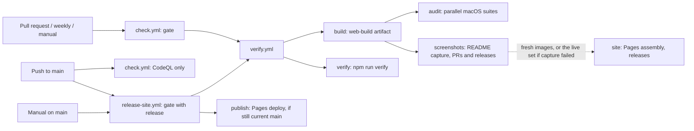

# GitHub Actions system

Implemented 2026-11-05 under the owner's Actions architecture request. This document owns the workflow graph and operational behavior. [Repository configuration](repository-configuration.md) owns variables, secrets, environment settings and the historical release gate. [CleanStack](../architecture/cleanstack.md) and the [web quality contract](web-quality.md) retain architecture and acceptance authority.

## Purpose

The workflow set does three jobs, and each has one workflow that owns it:

1. **Judge every change.** `check.yml` runs the shared gate for pull requests, the weekly schedule and manual runs, and runs CodeQL on the source. For a pull request it also runs dependency review.
2. **Release the verified site.** `release-site.yml` runs the same gate on a push to `main` or a manual run on `main`, then publishes the site that the gate audited. Nothing else publishes.
3. **Find drift.** The weekly run in `check.yml` catches a dependency, browser or runner change between pushes.

## Structure

- `verify.yml`: the reusable gate, called with `release: true` or `false`. It defines six jobs: `workflows` lints every workflow; `build` builds the site once and keeps it as the `web-build` artifact; `verify` runs `npm run verify` and the dependency audit on the source; `audit` expands into parallel macOS jobs that run the rendered suites on the `web-build` artifact; `screenshots` captures and validates README views on pull requests and releases using the same artifact; `site`, on releases only, assembles and uploads the Pages artifact. A failed `screenshots` job fails a pull request but not a release (see [Automatic README screenshots](#automatic-readme-screenshots)).
- `check.yml`: pull requests, the weekly schedule and manual runs call the gate; CodeQL runs on pushes and pull requests; dependency review runs on pull requests.
- `release-site.yml`: the gate with `release: true`, then `publish`, the only job with `pages: write`. `publish` checks that the revision is still current `main`, deploys, and refreshes GitHub's cached README images. It never checks out source, installs packages or rebuilds.
- `.github/actions/setup-project/`: the one shared setup (Node 22 and the locked packages). A local action needs the checkout to exist first, so each job checks out before it calls the action.

The site is built once and every consumer reads that build. The audits and the Pages site both come from the `web-build` artifact, so what the audits test is what is published. The gate still runs `npm run verify` on the source as before.

The jobs run in parallel where they can. In a release, `screenshots` and then `site` run alongside `verify` and `audit`, and `publish` waits for every suite and the rest of the gate. Each suite gets its own runner, preview server and browser profile. The matrix trades additional runner setup time for a shorter critical path.

[The rendered audit runner](../../scripts/audit/rendered.ts) owns suite membership. `npm run audit:rendered` runs every suite locally, and `npm run audit:rendered -- accessibility-and-polish` runs a single suite. CI generates its matrix from the same runner and reports each suite separately. The suites cover interactions, recovery and other synthetic journeys, accessibility, reduced motion and portfolio polish. There are five suites because GitHub starts at most five macOS jobs at once here, and the runner refuses a sixth. The interaction audit runs in three parts, one in each of three suites, and the suites are balanced by measured time (see [Gate timing](#gate-timing-2026-11-26)). The audits use the Chrome that `scripts/lib/local-browser.ts` finds (the `CHROME_PATH` override, or the platform default).

Both builds receive the public repository variable `VITE_GOOGLE_CLIENT_ID`. A release fails with a redacted configuration error if it is empty. A pull request or weekly run can verify without a release client ID. No Google token, credential or private workbook data enters this path.

## Automatic README screenshots

Every pull request and eligible release regenerates and validates every README screenshot. `npm run capture:readme` serves the already-verified production build locally and drives headless Chrome through each view listed in `scripts/docs/readme-views.ts` (portfolio, expenses, month by month, checkpoints, a fund, import and Your data) in light and dark, plus a phone-sized portfolio. Every image is captured without the page background, sidebar or top bar, so its cards float on GitHub's own light or dark canvas. The crop follows what is painted (text, backgrounds, borders, inputs, graphics) inside the elements a view names, with a margin for shadows, and everything outside them is made invisible without moving anything, so a neighbouring element cannot leak into the picture. A new view needs no crop at all: it gets the page content and its banner. A view's optional `crop` in the manifest narrows that when the default is wrong. The phone portfolio keeps its own top bar and bottom navigation. The Pages assembly decodes every PNG and rejects it when it is mostly opaque, when content touches an edge (cut off), when a margin exceeds 12% (cropped too loosely) or when the left and right sides are very unevenly filled; the error names the file and the rule. These checks cannot judge empty space inside a card, so a new screen's first screenshot is worth one look. That manifest is keyed by every app route, so adding a route fails the TypeScript check until it is captured or skipped with a written reason. The README's "Every screen" gallery is generated from the same manifest by `npm run docs:readme`; `npm run verify` fails if it is out of date or if the README links an image that is not captured. It does not rebuild the app. The runner must expose `google-chrome`; the workflow resolves its executable into `CHROME_PATH` and fails clearly if it is unavailable. Local capture uses the installed browser or an explicit `CHROME_PATH` override.

Capture closes Chrome through the browser protocol and waits for shutdown before removing its temporary profile; a failed browser connection retains the bounded process-termination fallback. This avoids profile-writer races observed on the Linux runner during the link-preview release.

Capture fingerprints the checked application before starting the browser, then uses a fresh temporary profile, bypasses service workers and restricts page requests to the local preview. It checks for the signed-out demo, visible synthetic amounts, complete rendering and absence of unexpected requests or browser exceptions. No Google sign-in, financial write, personal browser profile or secret participates. These images establish presentation, not provider connectivity or physical-device support.

The artifact boundary is explicit:

| Path | Responsibility |
|---|---|
| `dist/web/` | Verified application, including its existing PWA manifest, asset fingerprint and precache list; unchanged by capture or assembly |
| `dist/readme/` | Generated light and dark PNGs for each view in `scripts/docs/readme-views.ts` and `portfolio-mobile.png`, plus `screenshots.json` with the revision, pre-capture app digest and image hashes/dimensions |
| `dist/pages/` | Pages staging tree: byte-identical checked app at its root, the screenshots and their receipt in `readme/` |

`npm run build:pages` validates the screenshot set, PNG integrity and dimensions, rejects unexpected files and symlinks, and checks the app and image bytes against the capture receipt. It then verifies the staged app bytes and final file tree. Capture and assembly each reject changes to the original application after its pre-capture fingerprint. The added delivery images are outside the verified application build and its generated precache list; they do not alter its fingerprint or require changing the PWA integrity check. This does not change the worker's existing same-origin runtime cache behavior. See [PWA boundaries](pwa.md).

The README references the stable Pages URLs under `https://albidr.github.io/FolioDash/readme/`. Images refresh with each release whose capture succeeds. Since 2026-11-26 (owner decision) a failed capture no longer prevents publication: the screenshots are documentation, and capture failures (browser start-up, timeouts, profile races) had blocked releases of an app that passed every check. On a release the `screenshots` job may fail; the `site` job then runs `npm run build:pages -- --carry-over <live site>`, which downloads the `readme/` images and receipt the live site already serves (only the names in `scripts/docs/readme-views.ts`) and publishes them unchanged beside the new app. Every image, framing and receipt check still applies, and the images must match the receipt they were published with; only the two checks that tie the receipt to this revision and this app are skipped, because the images belong to an earlier release. The run shows the failed `Validate README screenshots` job, a warning, and a summary line naming the revision. If the live set cannot be fetched or no longer matches the manifest (a view was added since the last release), the release still fails rather than publish a README with a broken image. Pull requests keep failing on screenshot problems, and a failed assembly of fresh images still prevents publication. No workflow edits the README, commits generated PNGs or receives `contents: write`. Pull-request runs validate screenshot framing and integrity using the release assembly command. Weekly runs skip screenshot capture. Publication stays in the release workflow. GitHub's image proxy keeps each image for ten minutes at every location, so after a deployment the README could keep showing the previous screenshots. The last step of the `publish` job in `release-site.yml` therefore reads the README's rendered image links through the API and sends GitHub's cache-purge request for each one that points at this release's `readme/` folder. It needs only the workflow's read-only token, never fails the release, and reports how many images it refreshed in the run summary. A browser's own copy can still last up to ten minutes. The hosted screenshot URL is the release output.

## Trigger and permission contract

| Entry point | Quality checks | Site publication |
|---|---|---|
| Pull request, including forks | `check.yml`: gate (lint, verify, dependency audit, audit) and CodeQL, dependency review and README screenshot validation | Never |
| Push to `main` | `check.yml`: CodeQL only; `release-site.yml`: gate, then publish | After the gate passes, if still current `main` |
| Weekly schedule | `check.yml`: gate and CodeQL | Never |
| Manual `check` on any branch | `check.yml`: gate and CodeQL | Never |
| Manual `Release site` on current `main` | `release-site.yml`: gate with release, then publish | After the gate passes, if still current `main` |
| Manual `Release site` on another branch | Gate and publish skipped | Never |

To release a changed public OAuth client ID or manually publish the site, update any needed repository variable, then open **Actions > Release site > Run workflow**, select `main`, and confirm **Run workflow**. `release-site.yml` runs the same gate as a push to `main` and then publishes. A rerun of an older revision cannot roll back current main: the publish job checks the live branch SHA first. Rerunning failed jobs within a day can reuse the run's existing artifact; after artifact expiry, start a fresh Release site run on current main.

The owner directed a single `main` branch for normal work. Local checks run before a direct push; the release gate still verifies the pushed revision and blocks publication on failure. GitHub does not require a pre-push status check for `main`.

The default token is read-only. Only the Pages deployment job receives `pages: write` and `id-token: write`; its GitHub API revision check also needs `contents: read`. The Node jobs execute repository code without deployment permissions or secrets. CodeQL separately receives `security-events: write` to upload analysis. Actions remain pinned to full commit SHAs, checkout credentials are not persisted, and no privileged PR deployment is used.

CodeQL runs independently so an application-check failure does not suppress security analysis. Its completion is not a Pages dependency, and scan upload success does not mean every security finding is resolved. Dependency review and npm audit both use moderate-or-greater severity; dependency review explains newly introduced PR risks while the audit examines the installed production dependency tree (development tooling is excluded while picomatch has no patched release; see dependencies.md). Neither substitutes for review of action/tool updates.

## Cancellation and current revisions

New pushes can supersede in-progress push verification for releases. Manual release verification uses a separate group. The publish job acquires its own concurrency slot after verification, so a newer push can start checking while publication is in progress.

Pages serializes only the deployment job, with `cancel-in-progress: false`. After acquiring that slot, it reads current main through the GitHub API and publishes only if the run SHA still matches. A superseded run records an explicit skip in the summary; an API failure blocks publication. A successful deployment records its SHA and URL in the summary. A branch can still advance after the final check; an already-started deployment completes and the next verified revision follows. This is not an atomic lock on Git pushes.

GitHub concurrency permits one running and one pending job by default; a newer pending job can replace the previous pending job, and dispatch order is not a guarantee of deployment order. The current-revision check therefore remains necessary. See [GitHub concurrency behavior](https://docs.github.com/en/actions/how-tos/write-workflows/choose-when-workflows-run/control-workflow-concurrency).

## Apps Script removal, 2026-11-19

The owner removed the Apps Script deployment on 2026-11-19: the `deploy-apps-script.yml` workflow, its `apps-script-deploy` environment, the `CLASPRC_JSON` secret, the `APPS_SCRIPT_*` and `VITE_GOOGLE_SCRIPT_ID` variables, and the server bundle and its check. It was manual and owner-only, and no runtime path used it. The direct browser route under FD-017 is unaffected, and its live proof is still open.

## Maintaining and checking workflows

Run `npm run verify:workflows` when changing any workflow. It uses actionlint 1.7.12 with archive SHA-256 values pinned in `scripts/verify/project/workflows.ts` for Linux/macOS on x64/arm64. The command needs Node 22.18 or newer, `tar` and GitHub release download access on its first run. It installs no npm dependencies. Downloads stay in the OS temporary cache; cached archives are checksum-verified on every invocation, and each binary extraction is temporary. Optional ShellCheck and Pyflakes integrations are disabled consistently; shell behavior needs its own syntax or synthetic checks.

Update the checker version and platform checksums together from its [official release](https://github.com/rhysd/actionlint/releases/tag/v1.7.12). Action updates require reviewing the upstream release, changing the complete SHA and its version comment together, and running workflow validation. Keep the shared action references consistent across workflows. Automated dependency commits remain incompatible with the approved human-attribution policy; alerts, scheduled audits and reviewed manual updates remain the maintenance path.

For an Actions change, also run `npm run verify` and `npm run audit:dependencies`. Workflow validation is a separate command because it concerns the CI definitions and needs a platform binary; it runs once in CI, without repeating in both application matrix jobs. A meaningful checker smoke test must reject a malformed workflow and an invalid expression, as well as accept the actual workflow set.

## Evidence and remaining limits

Read-only inspection on 2026-11-05 confirmed successful existing Pages runs, a main-only `github-pages` environment, no Apps Script environment protection, read-only default workflow permissions, full-SHA action pinning required, and no required status checks or pull requests. No settings or visibility were changed by this refactor. These observed facts supersede older statements that no site or environment rules exist; they do not establish completion of the historical release gate.

Local validation and the first pushed CI run are reported with the change. Synthetic preflight checks cover missing configuration, malformed JSON, stale revisions and API failures without creating real credentials or making external writes. Actionlint validates workflow definitions and expressions; it does not simulate GitHub scheduling, environment protection, remote deployment or browser authentication. PR/fork, scheduled, cancellation races and Apps Script execution need their own observed runs before being described as exercised. Financial behavior, real Google acceptance, physical-device acceptance, licence and release privacy gates are unchanged.

Local verification record, 2026-11-05: tested in an isolated full-history clone of the committed application plus only this Actions change, because the shared checkout also contains unrelated in-progress application edits. macOS, Node 26.13.0, synthetic fixtures: clean `npm ci --ignore-scripts`, `npm run verify:workflows`, `npm run verify` and `npm run audit:dependencies` passed. The application suite passed 637 tests in 49 files, plus three PNG integrity checks. Both deliberately malformed YAML and an undefined expression were rejected by actionlint. Synthetic preflight checks exercised seven Apps Script configuration cases, four Apps Script revision/API cases and four Pages revision/API cases without external writes. The declared Node 22/24 matrix and actual Pages artifact publication are verified separately by the pushed run; this local record does not stand in for those results.

## Manual Deploy site entry point, 2026-11-06

The owner requested manual runs of `deploy-site.yml` from GitHub. Its `workflow_dispatch` entry on main now calls the existing Verify pipeline. Verify exposes `workflow_call` and delegates the unchanged privileged publication steps to `publish-verified-site.yml`, avoiding a recursive workflow call. The dependency chain remains workflow lint, both Node verify/audit jobs, synthetic capture and artifact assembly, then publication of that same-run artifact. Other-branch manual Deploy site runs skip the release job. The existing current-main check, deployment concurrency, environment and permissions remain in force. No separate workflow was dispatched as part of this change.

Validation for this amendment: `npm run verify:workflows` passed with actionlint 1.7.12 across six workflows; `npm run verify` passed, including 762 tests across 58 files; `npm run audit:dependencies` reported zero vulnerabilities. A byte comparison confirmed that `publish-verified-site.yml` (then `publish-pages.yml`, renamed on 2026-11-19 to match its display name) preserves the prior publication workflow except its display name. These local checks establish configuration validity, not a completed manual GitHub run; manual dispatch remains NOT RUN. No repository/environment settings or credentials were changed.

## Chrome startup diagnostics, 2026-11-15

Runs for `a130127` and `569cdbd` passed project verification but the Node 22 interaction job timed out discovering Chrome before loading the application. The local synthetic-browser harness now retains a bounded 8 KB tail of Chrome startup stderr, reports an exited process and allows 30 seconds for browser discovery. The ordinary UI-state wait remains 10 seconds. All rendered assertions, local-only request interception, fresh-profile isolation and the required audit/deployment gates remain enabled; Chrome sandbox flags are unchanged. Local full verification and the 43-assertion/553-control rendered audit passed with this harness. Remote startup/deployment must be observed separately.

The `7f447b7` run started Chrome and passed project verification but sampled the RTL period-selection pill before its final geometry, failing its unchanged alignment assertion. The RTL probe now waits for the selector's actual running animations to settle instead of assuming a 240 ms sleep is sufficient. Alignment tolerance and all behavior assertions are unchanged. Scripts type/lint checks and the full local rendered audit passed (46 journey assertions, 553 control samples). The remote run remains the release gate.

## Independent verification jobs, 2026-11-15

The Node matrix no longer waits for workflow lint to finish before starting dependency installation and project checks. Workflow lint and the matrix have no data/artifact dependency. Publish verified site retains `needs: [workflows, verify]`, so no failed, cancelled or unfinished check can release the artifact. This removes a serial scheduling dependency without removing checks, changing permissions, adding jobs or changing the one checked artifact. The tradeoff is that Node jobs can consume runner time even if workflow lint fails. Timing savings depend on actual queue and job durations and are not claimed as a measured speedup.

## Failure triage, 2026-11-05 to 2026-11-19

Between 2026-11-05 and 2026-11-19 GitHub recorded 36 failed Verify or Release site runs out of about 120 Verify runs: 34 Verify and 2 Release site. Every failed run stopped before publication, so no failed revision reached the Pages site. Every revision the Release site did publish had passed the same gate. The 36 failures fall into five classes:

| Class | Runs | Cause | Response |
|---|---|---|---|
| Rendered assertions and runtime errors | 25 | 19 "Interaction regression" failures, one hover timeout, one "Interaction audit failed", three "Browser evaluation failed" and one blocked nonlocal request. Seventeen of the 19 regressions were on 2026-11-16, while layout was tuned for CI. | Errors name the failing check, a blocked request names its origin, and an evaluation error shows its exception line. Geometry is still open; see below. |
| Browser start-up and capture timeouts | 6 | Chrome did not expose its debugging port within 30 seconds, or a README capture waited past its budget. | Start-up is retried three times with a fresh profile. Assertion failures are never retried. |
| Profile cleanup race | 2 | `ENOTEMPTY` while removing Chrome's profile during README capture, on 2026-11-05. | Fixed on 2026-11-05 by closing through CDP and retrying the removal. No later failure of this kind. |
| Dependency advisory | 2 | `npm audit` reported high-severity advisories in the installed tree (picomatch on 2026-11-17) without a code change. | The audit covers production dependencies on 2026-11-17. Overrides pinned qs and minimatch on 2026-11-19. |
| Contributor identity | 1 | A commit authored as `ADR` was not in the allowed list when the policy checked it on 2026-11-13. | The allowed list now includes that name. Later runs passed. |

The 2026-11-19 hardening changes three things. `scripts/lib/startup-retry.ts` repeats a browser start-up that fails for a fixed reason, but never a permanent failure such as a missing executable, and `scripts/lib/local-browser.ts` uses it with a fresh profile per attempt. The harness error names the blocked origin, and the evaluation error shows the first line of the page exception. The audit job checks that `google-chrome` exists and prints its version and the font that `system-ui` resolves to, so a missing browser fails before the audit starts.

Open decisions that these changes do not settle:

- **Geometry depended on the runner's fonts, and the audit now runs on macOS.** The app's body font starts with `-apple-system` and SF Pro, which a Linux runner does not have. Commit messages from 2026-11-16 ("when text renders wider") fit that, but the cause is inferred, not reproduced, because the development machine has no Linux container. Since `0dbf65d` the audit job runs on `macos-15`, where the owner's fonts are present, and that run passed in about four minutes on Chrome 157 and macOS 15.8.2. The README capture in the site job still runs on Linux, so the published screenshots carry the Linux font rendering. Bundling the body font, so that every platform renders alike, remains an option the owner has not decided.
- **A new advisory can turn main red without a code change.** The audit stays on production dependencies at moderate or greater severity. The response is an override or a dated decision, not a weaker audit.
- **Required status checks are off by the owner's choice** (see [repository configuration](repository-configuration.md)). A failing commit can therefore land on `main`. The release gate is what keeps it off the Pages site.
- **The workflows run Node 22 only** since 2026-11-17 (`c567086`). [AGENTS.md](../../AGENTS.md) still says Node 22 and 24. The owner should decide which statement is right. Older sections that describe a Node 22 and 24 matrix are historical.
- **The hover assertion branches on the runner.** Headless Linux reports no fine pointer, so the CI run asserts that a hovered card does not lift and never checks the lift itself. The claim that no CDP emulation can change the pointer media has not been tested.

## Gate timing, 2026-11-26

Measured on the release run for `04b3212` (2 minutes 52 seconds from push to published site). Two paths finished within five seconds of each other and set that time: the `verify` job (2 minutes 32 seconds) and `build` followed by the `interactions` audit suite (2 minutes 27 seconds). Every other job finished earlier.

Inside `verify`, `npm run verify` took 136 seconds, and 83 of them were `test:scripts`. One file, `scripts/artifacts/pages.test.ts`, took 82 seconds: each of its 17 cases builds fifteen synthetic screenshots and the assembly decodes all of them, and the desktop fixtures were 2480 by 3600 pixels. The fixtures are now 1600 by 800, the smallest desktop picture the assembly accepts. Every framing and integrity check measures shares of the picture, so the cases and their assertions are unchanged. Locally the file went from 60 seconds to 9, and `npm run verify` is shorter by the same amount on every machine.

The workflow definitions were reviewed in the same pass and left as they are. Setup is about 10 seconds per job with the npm cache, the site is built once, the jobs already run in parallel, and no job repeats another's work beyond the one-second build inside `npm run verify`.

After that change the `interactions` suite set the release time: one script, about 100 seconds for 27 rendered states, after about 35 seconds of build and runner setup. On the owner's go-ahead the same day, `scripts/audit/interactions.ts` lists its eight journeys in three named parts, and the rendered audit runner runs each part as its own suite:

| Part | Journeys | Rendered states | Assertions | Control samples |
|---|---|---|---|---|
| `portfolio` | portfolio, range selector, disclosures | 4 | 75 | 300 |
| `records` | holdings, expenses and import, history | 12 | 50 | 490 |
| `phone` | phone, earlier history | 11 | 35 | 341 |

Every journey belongs to exactly one part, because the parts are the only list of journeys, and the order within a part is the order the full audit used. The disclosures journey depends on the Portfolio that the range selector journey leaves open, so the two share a part. The other parts start with their own navigation, and each passed alone. Each part checks every control it renders against the same rules and fails on the same problems. Locally on 2026-11-26 the three parts made 160 journey assertions and 1,131 control samples across 27 states, exactly what the full audit made in one browser. `npm run audit:interactions` with no part still runs the whole audit in one browser and writes `report.json`. A part writes `report.<part>.json`. Each part pays its own runner setup and browser start-up, about 35 seconds, in exchange for running in parallel. Locally the parts took 46, 37 and 49 seconds against 86 for the whole audit. The first pushed run, for `1bd5e7c`, was slower, not faster: 4 minutes 22 seconds from push to published site. Seven macOS suites were more than GitHub would start at once. Five started together, and the other two started within three seconds of the first two finishing, so the account runs at most five macOS jobs at a time. The motion suite, which had just gained the choreography audit, was one of the two that waited, and it ran for 2 minutes 38 seconds.

The audit times measured in that run, from the start of each audit to the end of its job, were: reduced motion 80 seconds, interaction part `portfolio` 77, part `records` 56, choreography 55, part `phone` 44, reload stability 43, portfolio polish 43, accessibility 42, and the other seven recovery audits 20 together. That is about 460 seconds of audits, so five runners cannot finish in less than about 92 seconds each. Each runner adds about 15 seconds of setup. The runner now has exactly five suites, packed from those times:

| Suite | Audits | Measured audit time |
|---|---|---|
| `interactions-portfolio` | interaction part `portfolio` | 77 s |
| `interactions-records-and-reload` | interaction part `records`, reload stability | 99 s |
| `interactions-phone-and-choreography` | interaction part `phone`, choreography | 99 s |
| `accessibility-and-polish` | accessibility, portfolio polish | 85 s |
| `reduced-motion-and-recovery` | reduced motion and the other seven recovery audits | 100 s |

`node scripts/audit/rendered.ts --matrix` fails if a sixth suite is added, so the limit cannot be exceeded silently. When an audit grows or a new one arrives, rebalance the five suites instead of adding one. The run for this change reports the result.
