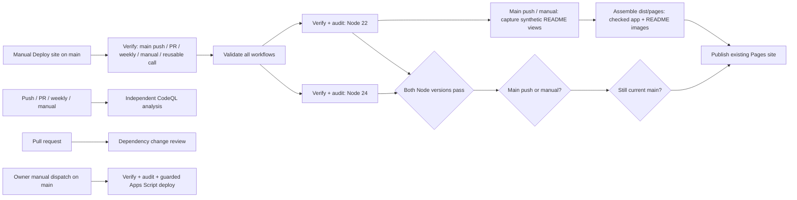

# GitHub Actions system

Implemented 2026-11-05 under the owner's Actions architecture request. This document owns the workflow graph and operational behavior. [Repository configuration](repository-configuration.md) owns variables, secrets, environment settings and the historical release gate. [CleanStack](../architecture/cleanstack.md) and the [web quality contract](web-quality.md) retain architecture and acceptance authority.

## One verification pipeline and one release artifact

`verify.yml` is the sole quality orchestrator. The dependency-free workflow validation job runs actionlint before the project installs dependencies. The Node 22 and 24 jobs each run `npm ci --ignore-scripts`, the complete `npm run verify` and `npm run audit:dependencies`. Complete Git history is available to contributor attribution. Attribution, punctuation and repository policy stay in the canonical verify command; separate workflow copies of those checks were removed.

Both builds receive the public repository variable `VITE_GOOGLE_CLIENT_ID` before verification. Main push/manual releases fail with a redacted configuration error if it is empty. A PR or weekly run can verify without a release client ID. No Google token, credential or private workbook data enters this path.

For a main push/manual release, the successful Node 22 job captures the README views from the exact `dist/web` directory produced by `npm run verify`, then assembles `dist/pages` from that unchanged application and the separate screenshot output. Upload is limited to those runs and retained for one day. Node 24 verifies compatibility but does not capture or upload a competing artifact. The entire matrix, including capture and assembly on Node 22, must pass before `publish-pages.yml` is called. That local reusable workflow comes from the caller's commit and consumes the same run's Pages artifact. It has no checkout, install or build step. No cross-run artifact retrieval or `workflow_run` privilege handoff is needed. GitHub documents these [reusable workflow semantics](https://docs.github.com/en/actions/how-tos/reuse-automations/reuse-workflows) and [Pages artifact/deployment requirements](https://docs.github.com/en/pages/getting-started-with-github-pages/using-custom-workflows-with-github-pages).

Before the 2026-11-05 pipeline consolidation, each main push ran the two-version matrix twice, then a separate Pages install/build. It now runs that matrix once and deploys the checked application with generated README images, eliminating two full verification jobs and the extra release build per push.

## Automatic README screenshots

Every eligible main push or manual Verify release regenerates the five README screenshots before artifact upload. `npm run capture:readme` serves the already-verified production build locally and drives headless Chrome through the portfolio and expenses demo in light, dark and phone-sized views. It does not rebuild the app. The runner must expose `google-chrome`; the workflow resolves its executable into `CHROME_PATH` and fails clearly if it is unavailable. Local capture uses the installed browser or an explicit `CHROME_PATH` override.

Capture fingerprints the checked application before starting the browser, then uses a fresh temporary profile, bypasses service workers and restricts page requests to the local preview. It checks for the signed-out demo, visible invented amounts, complete rendering and absence of unexpected requests or browser exceptions. No Google sign-in, financial write, personal browser profile or secret participates. These images establish presentation, not provider connectivity or physical-device support.

The artifact boundary is explicit:

| Path | Responsibility |
|---|---|
| `dist/web/` | Verified application, including its existing PWA manifest, asset fingerprint and precache list; unchanged by capture or assembly |
| `dist/readme/` | Generated `hero-light.png`, `hero-dark.png`, `expenses-light.png`, `expenses-dark.png` and `portfolio-mobile.png`, plus `screenshots.json` with the revision, pre-capture app digest and image hashes/dimensions |
| `dist/pages/` | Pages staging tree: byte-identical checked app at its root, the five screenshots and their receipt in `readme/` |

`npm run prepare:pages` validates the screenshot set, PNG integrity and dimensions, rejects unexpected files and symlinks, and checks the app and image bytes against the capture receipt. It then verifies the staged app bytes and final file tree. Capture and assembly each reject changes to the original application after its pre-capture fingerprint. The added delivery images are outside the verified application build and its generated precache list; they do not alter its fingerprint or require changing the PWA integrity check. This does not change the worker's existing same-origin runtime cache behavior. See [PWA boundaries](pwa.md).

The README references the stable Pages URLs under `https://albidr.github.io/FolioDash/readme/`. Images refresh with the next successful release; a failed capture or assembly prevents publication. No workflow edits the README, commits generated PNGs or receives `contents: write`. Pull-request and weekly Verify runs retain their existing checks without capture or publication. GitHub's image proxy may retain an older response briefly after a deployment; the hosted screenshot URL is the release output.

## Trigger and permission contract

| Entry point | Quality checks | Site publication | Apps Script credential |
|---|---|---|---|
| Push to `main` | Workflow lint + Node 22/24 verify/audit; independent CodeQL | After both versions pass, if still current main | Unavailable |
| Pull request, including forks | Workflow lint + Node 22/24 verify/audit; CodeQL; dependency review | Never | Unavailable |
| Weekly Verify schedule | Workflow lint + Node 22/24 verify/audit | Never | Unavailable |
| Manual Verify on current `main` | Workflow lint + Node 22/24 verify/audit | After success; rebuilds public configuration | Unavailable |
| Manual Deploy site on current `main` | Same Verify workflow: workflow lint + Node 22/24 verify/audit and fresh artifact | After success, if still current main | Unavailable |
| Manual Deploy site on another branch | Release job skipped | Never | Unavailable |
| Manual Verify on another branch | Workflow lint + Node 22/24 verify/audit | Never | Unavailable |
| Manual Apps Script on current `main`, original actor and rerun actor both owner | Node 22 full-history verify + audit | Never | Environment secret, only in the credential-writing step |
| Apps Script on another branch or by another actor | Deployment job skipped | Never | Unavailable |

To release a changed public OAuth client ID or manually publish the site, update any needed repository variable, then open **Actions > Deploy site > Run workflow**, select `main`, and confirm **Run workflow**. `deploy-pages.yml` now provides that manual entry point and calls the canonical reusable `verify.yml`; it does not duplicate the matrix or bypass checks. **Verify** remains manually runnable too. Both paths call the internal `publish-pages.yml` only after successful verification and use the checked artifact from the same run. A rerun of an older revision cannot roll back current main: the deployment checks the live branch SHA first. Rerunning failed jobs within a day can reuse the run's existing artifact; after artifact expiry, start a fresh Verify run on current main.

The default token is read-only. Only the Pages deployment job receives `pages: write` and `id-token: write`; its GitHub API revision check also needs `contents: read`. The Node jobs execute repository code without deployment permissions or secrets. CodeQL separately receives `security-events: write` to upload analysis. Actions remain pinned to full commit SHAs, checkout credentials are not persisted, and neither `pull_request_target` nor a privileged PR deployment is used.

CodeQL runs independently so an application-check failure does not suppress security analysis. Its completion is not a Pages dependency, and scan upload success does not mean every security finding is resolved. Dependency review and npm audit both use moderate-or-greater severity; dependency review explains newly introduced PR risks while the audit examines the installed dependency tree, including development tooling. Neither substitutes for review of action/tool updates.

## Cancellation and current revisions

Workflow validation and each Node job use separate concurrency groups by entry workflow, event, ref and, for the matrix, Node version. Manual Deploy site and manual Verify therefore do not cancel one another's checks. New pushes supersede older push checks; a scheduled/manual run does not cancel push verification. There is no workflow-level cancellation that could interrupt a Pages deployment after checks finish.

Pages serializes only the deployment job, with `cancel-in-progress: false`. After acquiring that slot, it reads current main through the GitHub API and publishes only if the run SHA still matches. A superseded run records an explicit skip in the summary; an API failure blocks publication. A successful deployment records its SHA and URL in the summary. A branch can still advance after the final check; an already-started deployment completes and the next verified revision follows. This is not an atomic lock on Git pushes.

GitHub concurrency permits one running and one pending job by default; a newer pending job can replace the previous pending job, and dispatch order is not a guarantee of deployment order. The current-revision check therefore remains necessary. See [GitHub concurrency behavior](https://docs.github.com/en/actions/how-tos/write-workflows/choose-when-workflows-run/control-workflow-concurrency).

## Retained Apps Script deployment

FD-017 retains Apps Script pending replacement proof. Its workflow remains manual, on current main, with both the original actor and the rerun actor equal to the repository owner. Read-only inspection found no protection rules or branch restriction on `apps-script-deploy`; the actor/ref guards implement the documented fallback, not a protected-environment claim.

The job checks the complete source/history and dependency audit, then installs the exact clasp version under runner temporary storage with package lifecycle scripts disabled. It does not install packages while credentials are on disk. The top-level CLI version is pinned; its separate npm-resolved transitive dependencies are not locked by the application lockfile.

Before remote writes, the job rejects an obsolete SHA and validates the presence of the credential, script ID and deployment ID. Malformed credential JSON yields a redacted error. It then creates private credential/link files, pushes the already-checked Apps Script bundle and redeploys the existing deployment ID. Cleanup runs even after failure. There is no duplicate bundle build after `npm run verify`.

`clasp push` and redeploy are separate external writes. A failure after push can leave the remote project updated without moving its executable deployment. Inspect the remote outcome before another dispatch; the workflow does not retry either operation automatically. This refactor did not dispatch Apps Script, provision resources, alter environment protection or remove the service.

## Maintaining and checking workflows

Run `npm run verify:workflows` when changing any workflow. It uses actionlint 1.7.12 with archive SHA-256 values pinned in `scripts/verify-workflows.ts` for Linux/macOS on x64/arm64. The command needs Node 22.18 or newer, `tar` and GitHub release download access on its first run. It installs no npm dependencies. Downloads stay in the OS temporary cache; cached archives are checksum-verified on every invocation, and each binary extraction is temporary. Optional ShellCheck and Pyflakes integrations are disabled consistently; shell behavior needs its own syntax or synthetic checks.

Update the checker version and platform checksums together from its [official release](https://github.com/rhysd/actionlint/releases/tag/v1.7.12). Action updates require reviewing the upstream release, changing the complete SHA and its version comment together, and running workflow validation. Keep the shared action references consistent across workflows. Automated dependency commits remain incompatible with the approved human-attribution policy; alerts, scheduled audits and reviewed manual updates remain the maintenance path.

For an Actions change, also run `npm run verify` and `npm run audit:dependencies`. Workflow validation is a separate command because it concerns the CI definitions and needs a platform binary; it runs once in CI, without repeating in both application matrix jobs. A meaningful checker smoke test must reject a malformed workflow and an invalid expression, as well as accept the actual workflow set.

## Evidence and remaining limits

Read-only inspection on 2026-11-05 confirmed successful existing Pages runs, a main-only `github-pages` environment, no Apps Script environment protection, read-only default workflow permissions, full-SHA action pinning required, and no required status checks or pull requests. No settings or visibility were changed by this refactor. These observed facts supersede older statements that no site or environment rules exist; they do not establish completion of the historical release gate.

Local validation and the first pushed CI run are reported with the change. Synthetic preflight checks cover missing configuration, malformed JSON, stale revisions and API failures without creating real credentials or making external writes. Actionlint validates workflow definitions and expressions; it does not simulate GitHub scheduling, environment protection, remote deployment or browser authentication. PR/fork, scheduled, cancellation races and Apps Script execution need their own observed runs before being described as exercised. Financial behavior, real Google acceptance, physical-device acceptance, licence and release privacy gates are unchanged.

Local verification record, 2026-11-05: tested in an isolated full-history clone of the committed application plus only this Actions change, because the shared checkout also contains unrelated in-progress application edits. macOS, Node 26.13.0, synthetic fixtures: clean `npm ci --ignore-scripts`, `npm run verify:workflows`, `npm run verify` and `npm run audit:dependencies` passed. The application suite passed 637 tests in 49 files, plus three PNG integrity checks. Both deliberately malformed YAML and an undefined expression were rejected by actionlint. Synthetic preflight checks exercised seven Apps Script configuration cases, four Apps Script revision/API cases and four Pages revision/API cases without external writes. The declared Node 22/24 matrix and actual Pages artifact publication are verified separately by the pushed run; this local record does not stand in for those results.

## Manual Deploy site entry point, 2026-11-06

The owner requested manual runs of `deploy-pages.yml` from GitHub. Its `workflow_dispatch` entry on main now calls the existing Verify pipeline. Verify exposes `workflow_call` and delegates the unchanged privileged publication steps to `publish-pages.yml`, avoiding a recursive workflow call. The dependency chain remains workflow lint, both Node verify/audit jobs, synthetic capture and artifact assembly, then publication of that same-run artifact. Other-branch manual Deploy site runs skip the release job. The existing current-main check, deployment concurrency, environment and permissions remain in force. No separate workflow was dispatched as part of this change.

Validation for this amendment: `npm run verify:workflows` passed with actionlint 1.7.12 across six workflows; `npm run verify` passed, including 762 tests across 58 files; `npm run audit:dependencies` reported zero vulnerabilities. A byte comparison confirmed that `publish-pages.yml` preserves the prior publication workflow except its display name. These local checks establish configuration validity, not a completed manual GitHub run; manual dispatch remains NOT RUN. No repository/environment settings or credentials were changed.
