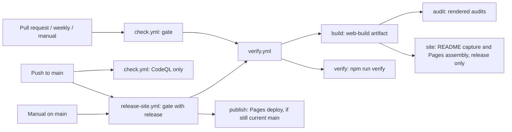

# GitHub Actions system

Implemented 2026-11-05 under the owner's Actions architecture request. This document owns the workflow graph and operational behavior. [Repository configuration](repository-configuration.md) owns variables, secrets, environment settings and the historical release gate. [CleanStack](../architecture/cleanstack.md) and the [web quality contract](web-quality.md) retain architecture and acceptance authority.

## Purpose

The workflow set does four jobs, and each has one workflow that owns it:

1. **Judge every change.** `check.yml` runs the shared gate for pull requests, the weekly schedule and manual runs, and runs CodeQL on the source. For a pull request it also runs dependency review.
2. **Release the verified site.** `release-site.yml` runs the same gate on a push to `main` or a manual run on `main`, then publishes the site that the gate audited. Nothing else publishes.
3. **Find drift.** The weekly run in `check.yml` catches a dependency, browser or runner change between pushes.
4. **Keep an owner-only Apps Script path.** `deploy-apps-script.yml` is manual, owner-only and kept until a decision is recorded after FD-017's live proof.

## Structure

- `verify.yml`: the reusable gate, called with `release: true` or `false`. It has five jobs: `workflows` lints every workflow; `build` builds the site once and keeps it as the `web-build` artifact; `verify` runs `npm run verify` and the dependency audit on the source; `audit` runs the rendered audits on the `web-build` artifact; `site` (release only) captures the README views and assembles the Pages site from the same artifact.
- `check.yml`: pull requests, the weekly schedule and manual runs call the gate; CodeQL runs on pushes and pull requests; dependency review runs on pull requests.
- `release-site.yml`: the gate with `release: true`, then `publish`, the only job with `pages: write`. `publish` checks that the revision is still current `main`, deploys, and refreshes GitHub's cached README images. It never checks out source, installs packages or rebuilds.
- `deploy-apps-script.yml`: the retained manual deployment.
- `.github/actions/setup-project/`: the one shared setup (Node 22 and the locked packages). A local action needs the checkout to exist first, so each job checks out before it calls the action.

The site is built once and every consumer reads that build. The audits and the Pages site both come from the `web-build` artifact, so what the audits test is what is published. The gate still runs `npm run verify` on the source as before.

The jobs run in parallel where they can. In a release, `site` runs alongside `verify` and `audit`, and `publish` waits for all of them.

`npm run audit:rendered` runs the ten rendered audits in order: interactions, backfill recovery, expense recovery and restore, sale closure, account outcomes, overview signals, checkpoints, accessibility and reduced motion. It is a single script so that CI and a developer run the same list. The audits use the Chrome that `scripts/lib/local-browser.ts` finds (the `CHROME_PATH` override, or the platform default); a missing browser fails the step with that module's message.

Both builds receive the public repository variable `VITE_GOOGLE_CLIENT_ID`. A release fails with a redacted configuration error if it is empty. A pull request or weekly run can verify without a release client ID. No Google token, credential or private workbook data enters this path.

## Automatic README screenshots

Every eligible main push or manual Verify release regenerates every README screenshot before artifact upload. `npm run capture:readme` serves the already-verified production build locally and drives headless Chrome through each view listed in `scripts/docs/readme-views.ts` (portfolio, expenses, month by month, checkpoints, a fund, import and Your data) in light and dark, plus a phone-sized portfolio. Every image is captured without the page background, sidebar or top bar, so its cards float on GitHub's own light or dark canvas. The crop follows what is painted (text, backgrounds, borders, inputs, graphics) inside the elements a view names, with a margin for shadows, and everything outside them is made invisible without moving anything, so a neighbouring element cannot leak into the picture. A new view needs no crop at all: it gets the page content and its banner. A view's optional `crop` in the manifest narrows that when the default is wrong. The phone portfolio keeps its own top bar and bottom navigation. The Pages assembly decodes every PNG and rejects it when it is mostly opaque, when content touches an edge (cut off), when a margin exceeds 12% (cropped too loosely) or when the left and right sides are very unevenly filled; the error names the file and the rule. These checks cannot judge empty space inside a card, so a new screen's first screenshot is worth one look. That manifest is keyed by every app route, so adding a route fails the TypeScript check until it is captured or skipped with a written reason. The README's "Every screen" gallery is generated from the same manifest by `npm run docs:readme`; `npm run verify` fails if it is out of date or if the README links an image that is not captured. It does not rebuild the app. The runner must expose `google-chrome`; the workflow resolves its executable into `CHROME_PATH` and fails clearly if it is unavailable. Local capture uses the installed browser or an explicit `CHROME_PATH` override.

Capture closes Chrome through the browser protocol and waits for shutdown before removing its temporary profile; a failed browser connection retains the bounded process-termination fallback. This avoids profile-writer races observed on the Linux runner during the link-preview release.

Capture fingerprints the checked application before starting the browser, then uses a fresh temporary profile, bypasses service workers and restricts page requests to the local preview. It checks for the signed-out demo, visible invented amounts, complete rendering and absence of unexpected requests or browser exceptions. No Google sign-in, financial write, personal browser profile or secret participates. These images establish presentation, not provider connectivity or physical-device support.

The artifact boundary is explicit:

| Path | Responsibility |
|---|---|
| `dist/web/` | Verified application, including its existing PWA manifest, asset fingerprint and precache list; unchanged by capture or assembly |
| `dist/readme/` | Generated light and dark PNGs for each view in `scripts/docs/readme-views.ts` and `portfolio-mobile.png`, plus `screenshots.json` with the revision, pre-capture app digest and image hashes/dimensions |
| `dist/pages/` | Pages staging tree: byte-identical checked app at its root, the screenshots and their receipt in `readme/` |

`npm run build:pages` validates the screenshot set, PNG integrity and dimensions, rejects unexpected files and symlinks, and checks the app and image bytes against the capture receipt. It then verifies the staged app bytes and final file tree. Capture and assembly each reject changes to the original application after its pre-capture fingerprint. The added delivery images are outside the verified application build and its generated precache list; they do not alter its fingerprint or require changing the PWA integrity check. This does not change the worker's existing same-origin runtime cache behavior. See [PWA boundaries](pwa.md).

The README references the stable Pages URLs under `https://albidr.github.io/FolioDash/readme/`. Images refresh with the next successful release; a failed capture or assembly prevents publication. No workflow edits the README, commits generated PNGs or receives `contents: write`. Pull-request and weekly Verify runs retain their existing checks without capture or publication. GitHub's image proxy keeps each image for ten minutes at every location, so after a deployment the README could keep showing the previous screenshots. The last step of `publish-verified-site.yml` therefore reads the README's rendered image links through the API and sends GitHub's cache-purge request for each one that points at this release's `readme/` folder. It needs only the workflow's read-only token, never fails the release, and reports how many images it refreshed in the run summary. A browser's own copy can still last up to ten minutes. The hosted screenshot URL is the release output.

## Trigger and permission contract

| Entry point | Quality checks | Site publication | Apps Script credential |
|---|---|---|---|
| Pull request, including forks | `check.yml`: gate (lint, verify, dependency audit, audit) and CodeQL and dependency review | Never | Unavailable |
| Push to `main` | `check.yml`: CodeQL only; `release-site.yml`: gate, then publish | After the gate passes, if still current `main` | Unavailable |
| Weekly schedule | `check.yml`: gate and CodeQL | Never | Unavailable |
| Manual `check` on any branch | `check.yml`: gate and CodeQL | Never | Unavailable |
| Manual `Release site` on current `main` | `release-site.yml`: gate with release, then publish | After the gate passes, if still current `main` | Unavailable |
| Manual `Release site` on another branch | Gate and publish skipped | Never | Unavailable |
| Manual Apps Script on current `main`, original actor and rerun actor both owner | Full-history verify and audit | Never | Environment secret, only in the credential-writing step |

To release a changed public OAuth client ID or manually publish the site, update any needed repository variable, then open **Actions > Deploy site > Run workflow**, select `main`, and confirm **Run workflow**. `deploy-site.yml` now provides that manual entry point and calls the canonical reusable `verify.yml`; it does not duplicate the matrix or bypass checks. **Verify** remains manually runnable too. Both paths call the internal `publish-verified-site.yml` only after successful verification and use the checked artifact from the same run. A rerun of an older revision cannot roll back current main: the deployment checks the live branch SHA first. Rerunning failed jobs within a day can reuse the run's existing artifact; after artifact expiry, start a fresh Verify run on current main.

The default token is read-only. Only the Pages deployment job receives `pages: write` and `id-token: write`; its GitHub API revision check also needs `contents: read`. The Node jobs execute repository code without deployment permissions or secrets. CodeQL separately receives `security-events: write` to upload analysis. Actions remain pinned to full commit SHAs, checkout credentials are not persisted, and neither `pull_request_target` nor a privileged PR deployment is used.

CodeQL runs independently so an application-check failure does not suppress security analysis. Its completion is not a Pages dependency, and scan upload success does not mean every security finding is resolved. Dependency review and npm audit both use moderate-or-greater severity; dependency review explains newly introduced PR risks while the audit examines the installed production dependency tree (development tooling is excluded while picomatch has no patched release; see dependencies.md). Neither substitutes for review of action/tool updates.

## Cancellation and current revisions

Workflow validation and each Node job use separate concurrency groups by entry workflow, event, ref and, for the matrix, Node version. Manual Deploy site and manual Verify therefore do not cancel one another's checks. New pushes supersede older push checks; a scheduled/manual run does not cancel push verification. There is no workflow-level cancellation that could interrupt a Pages deployment after checks finish.

Pages serializes only the deployment job, with `cancel-in-progress: false`. After acquiring that slot, it reads current main through the GitHub API and publishes only if the run SHA still matches. A superseded run records an explicit skip in the summary; an API failure blocks publication. A successful deployment records its SHA and URL in the summary. A branch can still advance after the final check; an already-started deployment completes and the next verified revision follows. This is not an atomic lock on Git pushes.

GitHub concurrency permits one running and one pending job by default; a newer pending job can replace the previous pending job, and dispatch order is not a guarantee of deployment order. The current-revision check therefore remains necessary. See [GitHub concurrency behavior](https://docs.github.com/en/actions/how-tos/write-workflows/choose-when-workflows-run/control-workflow-concurrency).

## Retained Apps Script deployment

FD-017 retains Apps Script pending replacement proof. Its workflow remains manual, on current main, with both the original actor and the rerun actor equal to the repository owner. Read-only inspection found no protection rules or branch restriction on `apps-script-deploy`; the actor/ref guards implement the documented fallback, not a protected-environment claim.

The job checks the complete source/history and dependency audit, then installs the exact clasp version under runner temporary storage with package lifecycle scripts disabled. It does not install packages while credentials are on disk. The top-level CLI version is pinned; its separate npm-resolved transitive dependencies are not locked by the application lockfile.

Before remote writes, the job rejects an obsolete SHA and validates the presence of the credential, script ID and deployment ID. Malformed credential JSON yields a redacted error. It then creates private credential/link files, pushes the already-checked Apps Script bundle and redeploys the existing deployment ID. Cleanup runs even after failure. There is no duplicate bundle build after `npm run verify`.

`clasp push` and redeploy are separate external writes. A failure after push can leave the remote project updated without moving its executable deployment. Inspect the remote outcome before another dispatch; the workflow does not retry either operation automatically. This refactor did not dispatch Apps Script, provision resources, alter environment protection or remove the service.

## Maintaining and checking workflows

Run `npm run verify:workflows` when changing any workflow. It uses actionlint 1.7.12 with archive SHA-256 values pinned in `scripts/verify/project/workflows.ts` for Linux/macOS on x64/arm64. The command needs Node 22.18 or newer, `tar` and GitHub release download access on its first run. It installs no npm dependencies. Downloads stay in the OS temporary cache; cached archives are checksum-verified on every invocation, and each binary extraction is temporary. Optional ShellCheck and Pyflakes integrations are disabled consistently; shell behavior needs its own syntax or synthetic checks.

Update the checker version and platform checksums together from its [official release](https://github.com/rhysd/actionlint/releases/tag/v1.7.12). Action updates require reviewing the upstream release, changing the complete SHA and its version comment together, and running workflow validation. Keep the shared action references consistent across workflows. Automated dependency commits remain incompatible with the approved human-attribution policy; alerts, scheduled audits and reviewed manual updates remain the maintenance path.

For an Actions change, also run `npm run verify` and `npm run audit:dependencies`. Workflow validation is a separate command because it concerns the CI definitions and needs a platform binary; it runs once in CI, without repeating in both application matrix jobs. A meaningful checker smoke test must reject a malformed workflow and an invalid expression, as well as accept the actual workflow set.

## Evidence and remaining limits

Read-only inspection on 2026-11-05 confirmed successful existing Pages runs, a main-only `github-pages` environment, no Apps Script environment protection, read-only default workflow permissions, full-SHA action pinning required, and no required status checks or pull requests. No settings or visibility were changed by this refactor. These observed facts supersede older statements that no site or environment rules exist; they do not establish completion of the historical release gate.

Local validation and the first pushed CI run are reported with the change. Synthetic preflight checks cover missing configuration, malformed JSON, stale revisions and API failures without creating real credentials or making external writes. Actionlint validates workflow definitions and expressions; it does not simulate GitHub scheduling, environment protection, remote deployment or browser authentication. PR/fork, scheduled, cancellation races and Apps Script execution need their own observed runs before being described as exercised. Financial behavior, real Google acceptance, physical-device acceptance, licence and release privacy gates are unchanged.

Local verification record, 2026-11-05: tested in an isolated full-history clone of the committed application plus only this Actions change, because the shared checkout also contains unrelated in-progress application edits. macOS, Node 26.13.0, synthetic fixtures: clean `npm ci --ignore-scripts`, `npm run verify:workflows`, `npm run verify` and `npm run audit:dependencies` passed. The application suite passed 637 tests in 49 files, plus three PNG integrity checks. Both deliberately malformed YAML and an undefined expression were rejected by actionlint. Synthetic preflight checks exercised seven Apps Script configuration cases, four Apps Script revision/API cases and four Pages revision/API cases without external writes. The declared Node 22/24 matrix and actual Pages artifact publication are verified separately by the pushed run; this local record does not stand in for those results.

## Manual Deploy site entry point, 2026-11-06

The owner requested manual runs of `deploy-site.yml` from GitHub. Its `workflow_dispatch` entry on main now calls the existing Verify pipeline. Verify exposes `workflow_call` and delegates the unchanged privileged publication steps to `publish-verified-site.yml`, avoiding a recursive workflow call. The dependency chain remains workflow lint, both Node verify/audit jobs, synthetic capture and artifact assembly, then publication of that same-run artifact. Other-branch manual Deploy site runs skip the release job. The existing current-main check, deployment concurrency, environment and permissions remain in force. No separate workflow was dispatched as part of this change.

Validation for this amendment: `npm run verify:workflows` passed with actionlint 1.7.12 across six workflows; `npm run verify` passed, including 762 tests across 58 files; `npm run audit:dependencies` reported zero vulnerabilities. A byte comparison confirmed that `publish-verified-site.yml` (then `publish-pages.yml`, renamed on 2026-11-19 to match its display name) preserves the prior publication workflow except its display name. These local checks establish configuration validity, not a completed manual GitHub run; manual dispatch remains NOT RUN. No repository/environment settings or credentials were changed.

## Chrome startup diagnostics, 2026-11-15

Runs for `a130127` and `569cdbd` passed project verification but the Node 22 interaction job timed out discovering Chrome before loading the application. The local synthetic-browser harness now retains a bounded 8 KB tail of Chrome startup stderr, reports an exited process and allows 30 seconds for browser discovery. The ordinary UI-state wait remains 10 seconds. All rendered assertions, local-only request interception, fresh-profile isolation and the required audit/deployment gates remain enabled; Chrome sandbox flags are unchanged. Local full verification and the 43-assertion/553-control rendered audit passed with this harness. Remote startup/deployment must be observed separately.

The `7f447b7` run started Chrome and passed project verification but sampled the RTL period-selection pill before its final geometry, failing its unchanged alignment assertion. The RTL probe now waits for the selector's actual running animations to settle instead of assuming a 240 ms sleep is sufficient. Alignment tolerance and all behavior assertions are unchanged. Scripts type/lint checks and the full local rendered audit passed (46 journey assertions, 553 control samples). The remote run remains the release gate.

## Independent verification jobs, 2026-11-15

The Node matrix no longer waits for workflow lint to finish before starting dependency installation and project checks. Workflow lint and the matrix have no data/artifact dependency. Publish verified site retains `needs: [workflows, verify]`, so no failed, cancelled or unfinished check can release the artifact. This removes a serial scheduling dependency without removing checks, changing permissions, adding jobs or changing the one checked artifact. The tradeoff is that Node jobs can consume runner time even if workflow lint fails. Timing savings depend on actual queue and job durations and are not claimed as a measured speedup.
